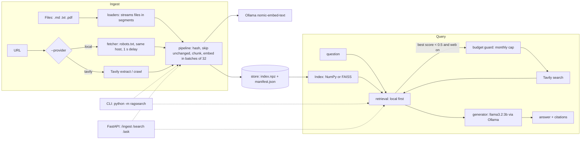

# ragsearch

[](https://github.com/TaiwoOpesade/ragsearch/actions/workflows/ci.yml)

A free, local-first semantic search and question-answering (RAG) system, written from scratch in Python.

You point it at your notes, PDFs or web pages. It splits them into chunks, turns each chunk into a vector with a local embedding model, and stores the vectors on disk. You can then search by meaning, or ask a question and get an answer from a local LLM that cites its sources as [1], [2]. When your own documents don't cover a question, it can fall back to a live web search through Tavily's free plan, and it labels every result `local` or `web`.

Everything runs on your machine with [Ollama](https://ollama.com). The defaults suit a laptop with 8 GB of RAM and a 6 GB GPU. Nothing costs money: Tavily is optional and a local counter stops you before you use up the free monthly credits.

The project was built in five stages, each tagged in git (`stage-1` to `stage-5`). From stage 2 on, every behaviour got a failing test before its code.

## Architecture



| Module | Job |
|---|---|
| `chunker.py` | Splits text into overlapping word windows (200 words, 40 overlap), streaming across page and block boundaries. |
| `embedder.py` | `OllamaEmbedder` (real embeddings, with `nomic-embed-text`'s `search_document:` / `search_query:` prefixes) and `HashEmbedder` (offline, for tests). |
| `index.py`, `faiss_index.py` | The `Index` protocol, a NumPy brute-force index and a FAISS `IndexFlatIP` index. |
| `loaders.py` | Finds `.md`, `.txt` and `.pdf` files and reads them in bounded segments (UTF-8, or Windows-1252 with a warning). |
| `store.py` | Saves vectors, chunk text and a content hash per source in one atomic `data/index.npz`; merges saves from other processes. |
| `pipeline.py` | Ingests documents: skips unchanged sources, replaces changed ones, removes deleted files, embeds in batches. |
| `retrieval.py` | Hybrid search: local index first, Tavily only when local results are weak. |
| `generator.py` | Builds the grounded prompt and calls Ollama's `/api/chat`. |
| `eval.py` | recall@k and MRR over a labelled question set. |
| `web/fetcher.py`, `web/robots.py` | Free crawler using requests and trafilatura, with an RFC 9309 robots.txt matcher. |
| `web/tavily.py`, `web/budget.py` | Tavily REST client and the monthly credit guard (locked, so the CLI and API can share it). |
| `fileutil.py` | Atomic writes and a cross-process lock file, with no extra dependencies. |
| `cli.py`, `api.py`, `schemas.py` | Command line and HTTP front ends. |

## Setup

You need Python 3.10 or newer.

1. Install Ollama from [ollama.com/download](https://ollama.com/download), then pull the two models:

   ```bash
   ollama pull nomic-embed-text
   ollama pull llama3.2:3b
   ```

2. Create a virtual environment and install the dependencies:

   ```powershell
   python -m venv .venv
   .venv\Scripts\activate          # macOS/Linux: source .venv/bin/activate
   pip install -r requirements.txt
   ```

3. Optional: for web search and Tavily crawling, create a free key at [tavily.com](https://tavily.com) (1,000 credits a month, no card) and put it in a `.env` file in the project folder (gitignored; `.env.example` lists every setting):

   ```text
   TAVILY_API_KEY=tvly-...
   ```

   Or set it in your shell, which wins over `.env`:

   ```powershell
   $env:TAVILY_API_KEY = "tvly-..."     # bash: export TAVILY_API_KEY="tvly-..."
   ```

To try everything without Ollama, add `--embedder hash` to any command (or set `EMBEDDER=hash`). The hash embedder matches shared words rather than meaning, so use it for testing only.

## Command line

### Ingest files

```bash
python -m ragsearch ingest ./notes            # a directory, searched recursively
python -m ragsearch ingest ./notes/week1.pdf  # or one file
```

```text
Ingested 4 new chunks from 4 sources (0 unchanged, 0 failed). Index holds 4 chunks.
```

Run it again and unchanged files cost nothing: ragsearch compares a SHA-256 hash of each file's text with the manifest and skips it before embedding. A file that changed has its old chunks replaced. When you ingest a folder, files you deleted or renamed since last time are removed from the index (the summary says `N removed`), so stale text stops turning up. An unreadable file produces a warning and the rest carry on; a path that doesn't exist is an error.

### Ingest web pages

```bash
# one page, with the free local fetcher
python -m ragsearch ingest https://example.com/article

# a whole site: same host only, obeys robots.txt, waits 1 s between requests
python -m ragsearch ingest https://docs.example.com --crawl --max-pages 30 --max-depth 2 --provider local

# the same through Tavily (spends credits: crawl = 1 per 10 pages + 1 per 5 pages)
python -m ragsearch ingest https://docs.example.com --crawl --max-pages 30 --provider tavily
```

### Search

```bash
python -m ragsearch search "how do central banks control rising prices" -k 2
```

Output from the fixture corpus with `--embedder hash` (real embeddings give different scores):

```text
1. 0.140  [local]  C:/.../tests/fixtures/inflation.pdf
   Inflation is a sustained rise in the general price level of goods and services. Central banks raise interest rates to reduce consumer demand and bring inflat...
2. 0.000  [local]  C:/.../tests/fixtures/photosynthesis.md
   # Photosynthesis Photosynthesis is the process plants use to make glucose. Chlorophyll in the chloroplasts absorbs light energy, which converts carbon dioxid...
```

Add `--web` to fall back to Tavily search when the best local score is below `WEB_FALLBACK_THRESHOLD` (default 0.5). ragsearch embeds the web snippets with the same model and ranks them together with your local chunks. Web results stay in memory unless you add `--save-web`, which never replaces a page you already ingested in full. A URL that is already in your local results isn't repeated from the web.

### Evaluate retrieval

```bash
python -m ragsearch eval tests/fixtures/labelled.json -k 3
```

The labelled file is a JSON list of `{"question": ..., "expected_source": ...}`. A source matches when it ends with the expected name, so `stacks.md` matches a full path. On the six fixture questions, the offline hash embedder scores:

| k | recall@k | MRR@k |
|---:|---:|---:|
| 1 | 0.833 | 0.833 |
| 3 | 1.000 | 0.917 |

These numbers come from `--embedder hash` on a four-document corpus. Nobody has measured `nomic-embed-text` on this set yet; run the same command without `--embedder hash` to do it.

## HTTP API

```bash
uvicorn --factory ragsearch.api:create_app
```

The server listens on `http://127.0.0.1:8000`. FastAPI also serves interactive docs at `/docs`.

| Method | Path | Body | Returns |
|---|---|---|---|
| GET | `/health` | none | `status`, `chunks`, `embedder`, `index_backend` |
| POST | `/ingest` | `{"path": "./notes"}` or `{"url": "https://...", "crawl": true, "max_pages": 30, "max_depth": 2, "provider": "local"}` | `added`, `updated`, `skipped`, `failed`, `removed`, `total_chunks` |
| POST | `/search` | `{"query": "...", "k": 5, "web": false, "save_web": false}` | `results[]` with `score`, `source`, `text`, `origin`; `warnings[]` |
| POST | `/ask` | `{"question": "...", "k": 5, "web": false}` | `answer`, `citations[]` (`number`, `source`, `origin`), `results[]`, `warnings[]` |

```bash
curl -X POST http://127.0.0.1:8000/ask -H "Content-Type: application/json" \
     -d '{"question": "What order does a stack remove items in?", "k": 3}'
```

```powershell
Invoke-RestMethod -Method Post http://127.0.0.1:8000/ask -ContentType application/json `
  -Body '{"question": "What order does a stack remove items in?", "k": 3}'
```

```json
{
  "answer": "A stack removes the most recently added item first [1].",
  "citations": [{"number": 1, "source": "C:/.../stacks.md", "origin": "local"}],
  "results": [{"number": 1, "score": 0.61, "source": "C:/.../stacks.md", "text": "...", "origin": "local"}],
  "warnings": []
}
```

That JSON is illustrative: the shape is exact, but the answer text and scores depend on your model and documents. The prompt numbers each source, tells the model to answer only from them and to cite them, and to reply "I don't know based on the provided sources." when they don't contain the answer. With an empty index, `/ask` returns that reply without calling the model. ragsearch sizes Ollama's context window to the prompt (up to 16,384 tokens), so a large `k` never silently cuts off the instructions or the best sources.

Errors map to HTTP codes: 503 when Ollama is unreachable, 422 for bad input, a missing path or an unfetchable page, and, for `/ingest` with `"provider": "tavily"`, 502 for Tavily errors and 429 when the credit budget would be exceeded. `/search` and `/ask` never fail because of the web fallback: if Tavily isn't configured, is down or the budget is spent, they return the local results and say why in `warnings`. If `DATA_DIR` was built with a different embedder, the server refuses to start and prints one line saying so.

The API and the CLI can work on the same data directory at once: saves take a lock file and merge with each other, and the server reloads the index before each request.

## Configuration

Settings come from environment variables, or from a `.env` file in the folder you run ragsearch from. A variable set in your shell overrides the file. Values are trimmed, an empty value means the default, and a bad value (say `TAVILY_MONTHLY_CAP=lots`) stops with one line naming the variable. A `.env` saved as UTF-16 by PowerShell works too.

| Variable | Default | Meaning |
|---|---|---|
| `OLLAMA_HOST` | `http://127.0.0.1:11434` | Ollama server. `localhost` is rewritten to `127.0.0.1`: on Windows it tries IPv6 first and every request waited about 5 s (ingest 9.6 s vs 1.4 s, measured). |
| `EMBED_MODEL` | `nomic-embed-text` | Ollama embedding model. |
| `GEN_MODEL` | `llama3.2:3b` | Ollama chat model for `/ask`. |
| `EMBEDDER` | `ollama` | `ollama` or `hash`. The CLI's `--embedder` overrides it. |
| `DATA_DIR` | `data` | Index, manifest and Tavily usage file. The CLI's `--data-dir` overrides it. |
| `INDEX_BACKEND` | `numpy` | `numpy` or `faiss`. |
| `TAVILY_API_KEY` | unset | Needed only for `--provider tavily`, `--web` and `"web": true`. |
| `TAVILY_MONTHLY_CAP` | `800` | ragsearch refuses any Tavily call that would take this month's usage past the cap. |
| `WEB_FALLBACK_THRESHOLD` | `0.5` | Web search runs only when the best local score is below this. |

The default cap of 800 leaves 200 of the 1,000 free credits as a safety margin. Costs follow Tavily's published prices: search 1 credit (basic) or 2 (advanced), extract 1 per 5 URLs, map 1 per 10 pages, crawl = map + extract. Before every call, ragsearch books the worst case for that call (for a crawl, the cost of `--max-pages` pages) under a lock file, then settles to what Tavily reports it charged (`include_usage`). A call that never reached Tavily gives its credits back; one that may have been charged (a timeout after sending) keeps them, so the counter never under-counts. Connection failures and 502/503/504 replies are retried twice with a short backoff, since Tavily doesn't charge for those.

## Benchmark: NumPy vs FAISS

`scripts/benchmark_index.py` times both index backends on random 768-dimension vectors (the size `nomic-embed-text` produces). These are the measured results from `docs/benchmarks.md`:

| Vectors | NumPy build (ms) | FAISS build (ms) | NumPy search (ms/query) | FAISS search (ms/query) | FAISS speed-up |
|---:|---:|---:|---:|---:|---:|
| 1000 | 3.522 | 4.775 | 0.2089 | 0.1269 | 1.65x |
| 10000 | 40.02 | 45.75 | 1.943 | 2.369 | 0.82x |
| 100000 | 419.3 | 640.5 | 27.69 | 35.83 | 0.773x |

Machine: Windows 11 laptop, Intel CPU, Python 3.14.3, NumPy 2.5.4, faiss-cpu 1.15.1. Median of 200 single queries, top-10.

FAISS was not faster here. Both backends do exact brute-force search, which is limited by memory bandwidth, and NumPy's matrix-vector product already uses an optimised BLAS. FAISS's flat index pays off for batches of queries or with approximate indexes (IVF, HNSW), which this project doesn't use. That result is why `numpy` stays the default. Repeated runs on the same laptop varied by up to about 3x at 1,000 vectors, so treat small differences as noise. Run the script yourself to measure your machine:

```bash
python scripts/benchmark_index.py
```

## Limitations

- **The hash embedder is not semantic.** It only matches shared words. With it, "which data structure is last in first out" ranks `queues.txt` above `stacks.md`, because the queues file repeats "first in first out" and "data structure". Use Ollama for real searches.
- **Untested against real Ollama.** Ollama wasn't running on the build machine, so embeddings and answers have only run against local stub servers. Tavily search and extract, the `--web` fallback and the local crawler were checked against the real services on 2026-10-19 (3 credits). The 0.5 threshold is a starting point that nobody has tuned for `nomic-embed-text` scores.
- **Exact search keeps everything in RAM.** The store holds every vector, the search index holds a normalised copy, and the chunk text stays loaded. Measured with 20,000 chunks of 200 words at 768 dimensions: 159 MB steady and 220 MB peak while loading and running the first search. Memory grows linearly, so 100,000 chunks need roughly 0.8 GB, peaking near 1.1 GB.
- **PDFs need a text layer.** pypdf extracts embedded text only. Scanned PDFs give no text because there is no OCR.
- **Text files must be UTF-8 or Windows-1252.** Other encodings are read as Windows-1252, and UTF-16 files are rejected with a message asking you to save them as UTF-8.
- **The crawler reads static HTML only.** It doesn't run JavaScript or read sitemaps, and it treats `www.example.com` and `example.com` as different hosts. It is stricter than RFC 9309 in one place: a robots.txt answered with 401 or 403 means "don't crawl".
- **The credit counter only sees this install.** It doesn't know about credits you spent from another machine or the Tavily dashboard.
- **Citations are not fact-checked.** The API reports which sources the model cited. A 3B model can still cite the wrong source or add claims the source doesn't make.
- **The API has no authentication.** Keep it on `127.0.0.1`. `POST /ingest` with a `path` reads any file the server process can read.
- **Changing the embedding model needs a new data directory.** ragsearch refuses to mix vectors from different embedders and tells you so.
- **Two processes ingesting the same file at the same moment.** Saves merge, but if both change the same source, the one that saves last wins for that source.

## Development

```bash
python -m pytest -W error     # 395 pass, 4 live tests skip; no Ollama, internet or API key needed
ruff check .
```

Tests use real local HTTP stub servers for Ollama, Tavily and the crawler, plus a minimal PDF writer, so they run offline. Tests marked `live` talk to real services and are skipped unless you set `RAGSEARCH_LIVE=1`. Running them spends one real Tavily credit if `TAVILY_API_KEY` is set (it is recorded in your usage file), and they fetch `https://example.com`. CI never sets that variable.

CI (`.github/workflows/ci.yml`) runs ruff and pytest on Windows and Linux with Python 3.10, 3.12 and 3.13.

`requirements.txt` is generated from `pyproject.toml`; the command to regenerate it is in its header.

One warning is silenced on purpose: Starlette 1.9 asks for a new `httpx2` package for FastAPI's `TestClient`. `httpx2` is not on this project's approved dependency list, so `tests/test_api.py` ignores that single deprecation message and every other warning still fails the run.

```text
ragsearch/        package (CLI, API, pipeline, indexes, web clients)
ragsearch/web/    Tavily client, credit budget, crawler, robots.txt matcher
tests/            pytest suite; tests/fixtures holds the sample corpus and labelled.json
scripts/          benchmark_index.py
docs/             benchmarks.md (generated)
```
